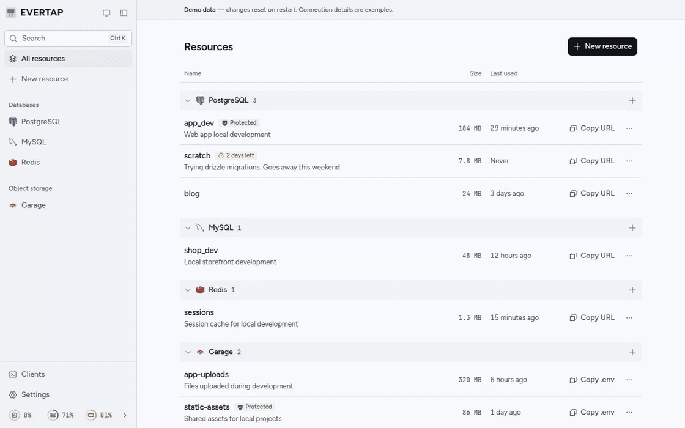

<h1>
  <picture>
    <source media="(prefers-color-scheme: dark)" srcset=".github/assets/logo-dark.png">
    
  </picture>
</h1>

**Databases and buckets for development, with no `db:` service in each project's Docker Compose.**

evertap runs PostgreSQL®, MySQL®, Redis®, and S3-compatible buckets (Garage) in Docker on one
machine: the computer you develop on, a home server, or a VPS. Create one from the web UI or the
CLI and copy its connection details. There is nothing to write and no port to pick, and it keeps
running for every project you work on.

<picture>
  <source media="(prefers-color-scheme: dark)" srcset=".github/assets/demo-dark.gif">
  
</picture>

[Website](https://evertap.dev) · [Docs](https://evertap.dev/docs/install) ·
[Limitations](https://evertap.dev/docs/limitations)

## Create a database

```sh
evertap create postgres blog   # prints the connection details
evertap env blog >> .env
```

It adds a line like this:

```sh
DATABASE_URL=postgres://evertap_k3x9q2m7v1ab:…@ev.internal:5432/evertap_k3x9q2m7v1ab
```

Every database URL and bucket endpoint points at `ev.internal` on the engine's standard port,
whichever machine runs evertap. When you set evertap up for this computer only, apps there reach
that name directly; on a laptop, `evertap connect` carries the connections to the machine running
evertap. `evertap help` lists every command ([CLI](https://evertap.dev/docs/cli)).

## Why use it

- **No ports to pick.** Every project uses the standard ports (5432, 3306, 6379, and 3900), and
  evertap tells databases apart by the user in the URL.
- **The same `.env` everywhere.** A project's connection details stay the same when you work from
  another laptop or change how evertap is reached.
- **Databases off your laptop.** With evertap on a home server or a VPS, your laptop needs no
  Docker, only the CLI.
- **A data browser.** Tables, rows, and SQL for PostgreSQL and MySQL; keys for Redis; objects in
  buckets.
- **Temporary, kept, or protected.** A temporary resource is deleted after 7 days without a
  connection unless you keep it, and a protected one cannot be deleted until you unprotect it.
- **pgvector included.** `evertap create postgres search --extension vector`.
- **Sign-in is always on.** A browser signs in with a code another signed-in browser approves, the
  CLI pairs with `evertap login`, and CI uses API keys.

evertap is for development, CI, and previews, not production. Not in v0.1: MCP for agents,
`evertap update` and `evertap repair`, and backups and restore
([Not in this version](https://evertap.dev/docs/limitations#not-in-this-version)).

## Coding agents

`evertap skills install` gives Claude Code, Codex, Cursor, and other agents a skill for the evertap
CLI, and `evertap login` offers it. With it, an agent creates the databases a task needs, writes
their connection details to `.env` without showing passwords, and makes throwaway ones temporary.

- An agent cannot grant itself access: approving a pairing and creating API keys happen only in
  the web UI.
- A protected resource cannot be deleted until it is unprotected, a separate step the skill tells
  agents to take only for resources you name.

## Install

The machine that runs evertap needs Linux with Docker Engine 24 or later, or macOS with Docker
Desktop, OrbStack, or Colima. On Linux, use Docker 28 or later: before it, other machines on your
network can reach what Docker publishes on 127.0.0.1.

```sh
curl -fsSL https://evertap.dev/install.sh | sh
```

The script asks whether this machine runs evertap or connects to one, and never guesses. On Linux
with systemd, it starts evertap as a service and runs `evertap setup`. Without systemd, as on
macOS, run `evertap serve` in a terminal and `evertap setup` in another. Setup asks where you will
open evertap from (this computer only, your network, your own proxy, or anywhere through a
Cloudflare Tunnel), then signs in your first browser.

evertap keeps its records in `~/.local/share/evertap` and touches only Docker containers, volumes,
and networks whose names start with `evertap`. `evertap uninstall` removes everything it made.

[Install](https://evertap.dev/docs/install) has every step and requirement, and
[Choose how evertap is reached](https://evertap.dev/docs/modes) explains each answer to setup. To
look around first, `EVERTAP_DEMO=1 evertap serve` shows the UI with sample data from memory,
starts nothing, and needs no sign-in.

## Connect from your laptop

On a laptop, install evertap with the same script, answering that it connects to evertap on another
machine. It needs no Docker there. Then run:

```sh
evertap login http://<server>:8080   # approve the code in a signed-in browser
evertap connect                      # keep it running
```

`evertap connect` prints the line to add to `/etc/hosts` (`127.77.0.1 ev.internal`) until it is
there. [Connect from your laptop](https://evertap.dev/docs/connecting) covers macOS, ports already
in use, signed links for buckets, and CI with an API key.

## Engines and their licenses

evertap does not include the engines. It pulls these images from Docker Hub the first time it needs
them, and each stays under its own license, which applies to your use of it.

| Service                            | Versions       | Image                             | License                                 |
| ---------------------------------- | -------------- | --------------------------------- | --------------------------------------- |
| PostgreSQL with pgvector           | 18, 17, 16, 15 | `pgvector/pgvector:pg<version>`   | PostgreSQL License                      |
| MySQL Community Server             | 9.7, 8.4       | `mysql:<version>`                 | GPL-2.0                                 |
| ProxySQL, in front of MySQL        | 3.0.2          | `proxysql/proxysql:3.0.2`         | GPL-3.0                                 |
| Redis                              | 8.10, 8.2      | `redis:<version>`                 | RSALv2, SSPLv1, or AGPLv3, at your pick |
| Redis                              | 7.4            | `redis:7.4`                       | RSALv2 or SSPLv1 only                   |
| Garage                             | 2.4.1          | `dxflrs/garage:v2.4.1`            | AGPL-3.0                                |
| cloudflared, for Cloudflare Tunnel | 2026.9.3       | `cloudflare/cloudflared:2026.9.3` | Apache-2.0                              |

Redis 7.4 has no OSI-approved open source license, and RSALv2 forbids offering Redis to others as a
service. Choose 8.2 or 8.10 when you need an open source license.

The first database of a version, or the first bucket, takes a few minutes while its image
downloads.

Each image is pinned by digest, so a database version runs the patch release that was newest when
your evertap was released, and pulling a newer one yourself, such as `docker pull mysql:8.4`, does
not change it. Updating evertap brings newer patch releases: when evertap starts, it replaces any of
its containers whose image or settings have changed, and keeps their data. The images they ran
stay on disk until you remove them, for example with `docker image prune -a`, which removes every
image no container uses.

## Contributing

Changes start with an issue: read [CONTRIBUTING.md](CONTRIBUTING.md) before you open a pull
request. It also covers live mode in development and the checks to run. To report a vulnerability,
follow [SECURITY.md](SECURITY.md). Everyone taking part follows the
[code of conduct](CODE_OF_CONDUCT.md), and [CHANGELOG.md](CHANGELOG.md) lists notable changes.

```sh
mise install
pnpm install
EVERTAP_DEMO=1 pnpm dev   # sample data, no Docker needed; UI on http://localhost:5173
```

- `apps/web`: the SPA (Vite, React, TanStack Router and Query)
- `apps/server`: the server (Bun, Hono, the Docker Engine API) and the CLI, built into one binary
- `packages/api`: the oRPC router and zod schemas, where the rules every interface shares live
- `packages/ui`: Base UI components styled with CSS Modules, and the design tokens

[AGENTS.md](AGENTS.md) holds the rules for contributors and coding agents, and
[DESIGN.md](DESIGN.md) the design system. Third-party notices are in
[THIRD_PARTY_NOTICES.md](THIRD_PARTY_NOTICES.md).

## Sponsoring

evertap is free for any use, at work included, and every feature stays free. If it saves you or
your team time, especially in a company, please consider
[sponsoring its development](https://github.com/sponsors/caru-ini).

## License

evertap is licensed under the [Apache License 2.0](LICENSE). The services it runs keep their own
licenses, listed in [Engines and their licenses](#engines-and-their-licenses).

## Trademarks

The evertap name and logo are not licensed with the code (section 6 of the license). You may use
them to refer to evertap, but not to name or brand your own product or service, or in a way that
suggests evertap made or endorses it, without permission.

evertap is an independent project. It is not affiliated with, endorsed, sponsored, supported, or
certified by the owners of the software it runs, and it uses their names only to say which software
that is.

- Postgres, PostgreSQL and the Slonik Logo are trademarks or registered trademarks of the PostgreSQL
  Community Association of Canada, and used with their permission.
- MySQL is a registered trademark of Oracle and/or its affiliates.
- Redis is a registered trademark of Redis Ltd. Any rights therein are reserved to Redis Ltd.
- Other names, including Garage and Cloudflare, may be trademarks of their respective owners.
